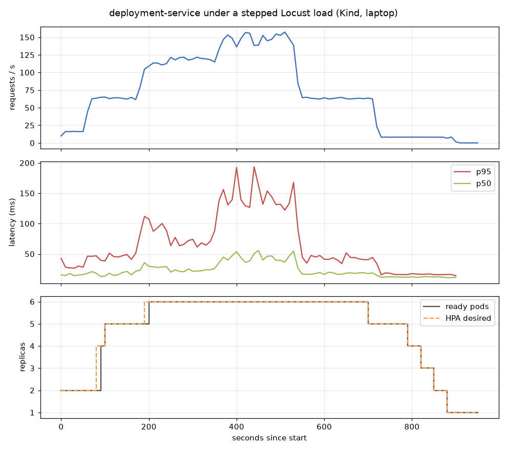

# MLOps Platform

A self-hosted machine learning operations platform that runs the full model lifecycle—dataset upload, training, registry, deployment, and monitoring—from a single web console. Version 1 delivers a working end-to-end pipeline with AI-assisted operations and containerized deployment infrastructure.

---

## What This Project Does

Most ML work stalls between a trained notebook and something others can actually use. This platform closes that gap by wiring each stage into one system:

| Stage | What happens |
|-------|--------------|
| **Datasets** | Upload CSV files, inspect column profiles, pick a target column |
| **Training** | Queue jobs on scikit-learn / XGBoost / LightGBM with logged metrics in MLflow |
| **Registry** | Persist trained models with version metadata |
| **Deployment** | Expose models as HTTP endpoints with inline prediction and SHAP explanation |
| **Monitoring** | Track prediction volume, latency, drift (PSI/KS), and request history |
| **AI Copilot** | Ask natural-language questions; the agent queries live platform data via tool calling |

---

## Decisions Made (v1)

These choices shaped the current architecture:

- **Microservices over monolith** — Dataset, training, deployment, monitoring, and AI services run independently behind an API Gateway. Each service owns one lifecycle stage and can be restarted or scaled without taking down the rest.
- **Docker Compose for local and demo deployments** — All services, PostgreSQL, Redis, MLflow, and Prometheus start with one command. v2 adds Kubernetes manifests (run on Kind); Compose and Render are unchanged.
- **Async training via Redis** — Training jobs are queued rather than blocking HTTP requests, so the UI stays responsive while long-running jobs execute.
- **MLflow for experiment tracking** — Every training run logs parameters, metrics, and artifacts to a dedicated MLflow server (port 5000).
- **Groq LLM with tool calling for the Copilot** — Instead of a static chatbot, the AI service calls 15 platform APIs (MLflow, Prometheus, training, deployment, monitoring) to answer from live data.
- **JWT auth at the gateway** — All API routes pass through the gateway, which validates tokens before proxying to downstream services.

---

## Constraints Faced

- **Single-node deployment** — v1 targets one machine running Docker Compose. v2 runs on Kubernetes, but has only been exercised on a one-node Kind cluster on a laptop.
- **Tabular ML only** — Training supports CSV datasets and classical / gradient-boosted models; deep learning and image pipelines are out of scope for v1.
- **Basic auth** — JWT login with admin/user roles. Enterprise SSO, OAuth, and fine-grained RBAC are deferred to v2.
- **Copilot requires an external LLM key** — The AI service needs a Groq API key (free tier available) to function.

---

## Outcomes Achieved (v1)

- End-to-end flow works: upload → train → deploy → predict → monitor
- Training metrics visible in both the UI and MLflow
- Deployed models serve predictions with latency tracking and SHAP explanations
- Drift detection (PSI/KS) runs against live prediction history
- Prometheus scrapes platform metrics; the Copilot can query them with PromQL
- Next.js dashboard connects to all backend services through the gateway

---

## Architecture

```
Browser (Next.js Dashboard)
         │
         ▼
   API Gateway :8000  ─── JWT auth, request routing
         │
    ┌────┼────────────┬──────────────┬─────────────┐
    ▼    ▼            ▼              ▼             ▼
Dataset Training  Deployment  Monitoring    AI Service
 :8001    :8002       :8003        :8004         :8005
    │       │            │              │             │
    └───────┴────────────┴──────────────┴─────────────┘
                         │
              PostgreSQL · Redis · MLflow · Prometheus
```

### Services

| Service | Port | Responsibility |
|---------|------|----------------|
| API Gateway | 8000 | Auth, routing, CORS |
| Dataset Service | 8001 | Upload, storage, profiling |
| Training Service | 8002 | Job queue, model training, registry |
| Deployment Service | 8003 | Model loading, inference, SHAP |
| Monitoring Service | 8004 | Prediction logging, drift, stats |
| AI Service | 8005 | LLM Copilot with tool calling |
| MLflow | 5000 | Experiment tracking UI |
| Prometheus | 9090 | Metrics collection |
| PostgreSQL | 5433 | Metadata and user store |
| Redis | 6379 | Training job queue |

---

## Getting Started

### Prerequisites

- Docker and Docker Compose
- Node.js 18+ and pnpm (for the frontend)
- A [Groq API key](https://console.groq.com) (for the AI Copilot)

### 1. Clone and configure

```bash
git clone <repository-url>
cd MLOPS_Platform
```

Create a `.env` file in the project root:

```env
GROQ_API_KEY=gsk_your_key_here
JWT_SECRET_KEY=<long random value>
ADMIN_PASSWORD=<choose a password>
```

The AI service reads this key at startup. See `backend/ai-service/.env.example` for additional LLM settings.

### 2. Start backend services

```bash
docker compose up --build
```

Wait until all containers are healthy. The API Gateway is available at `http://localhost:8000`.

The gateway creates an `admin` account from two settings in `.env` (see `.env.example`):

| Setting | What it does |
|---------|--------------|
| `ADMIN_PASSWORD` | Password for the `admin` account. If unset, no admin account is created. Changing it resets the password on the next start. |
| `JWT_SECRET_KEY` | Key that signs login tokens. Use a long random value and keep it secret. |

There is no default password.

### 3. Start the frontend

```bash
cd frontend/vertex-ai-frontend
pnpm install
```

Create `frontend/vertex-ai-frontend/.env.local`:

```env
NEXT_PUBLIC_API_BASE_URL=http://localhost:8000
NEXT_PUBLIC_POLLING_INTERVAL=5000
```

```bash
pnpm dev
```

Open `http://localhost:3000` and sign in as `admin` with your `ADMIN_PASSWORD`.

### 4. Verify the stack

| Check | URL |
|-------|-----|
| Gateway health | `http://localhost:8000/health` |
| MLflow UI | `http://localhost:5000` |
| Prometheus | `http://localhost:9090` |
| Copilot health | `http://localhost:8005/copilot/health` |

---

## v2: Operating Deployed Models (measured on Kind)

v2 adds the operations around a deployed model: Kubernetes, safe rollouts with automatic rollback, and drift-triggered retraining behind a promotion gate. Design and API: [docs/model-lifecycle-v2.md](docs/model-lifecycle-v2.md). Raw results: [docs/v2-results/](docs/v2-results/).

- **Kubernetes** ([k8s/](k8s/)): Kustomize manifests for the six services, the frontend, Postgres, Redis, MLflow and Prometheus, with startup/liveness/readiness probes, resource requests/limits, and a CPU HPA (1–6 replicas) on the deployment service. `scripts/kind-up.sh` builds, loads and applies everything on Kind.
- **Rollouts**: `POST /deployments/{id}/predict` serves through a deployment. A shadow candidate is scored and logged but never returned; a canary candidate answers a configurable share of traffic. A controller rolls the candidate back on error rate, p95 latency (absolute and relative to stable) or prediction drift against the stable model. Every promotion and rollback is an event in Postgres, shown on the Deployments page.
- **Retraining**: the monitoring service runs the existing PSI/KS drift code on each deployment's recent inputs. On a breach (with enough labelled feedback, no retrain in flight, outside a cooldown) it queues a retrain on recent labelled rows. The candidate is promoted only if it is not worse than the live model on the newest held-out rows. Thresholds, gate metric and margin are per-deployment policy.
- **Tests**: the rollback, promotion-gate and retrain-trigger rules are pure functions with unit tests. The rollout controller is also tested end to end against SQLite. All of it runs in CI with no cluster.

### Setup for every measurement

One-node Kind cluster (Kubernetes 1.32) in Docker Desktop on a Windows laptop: 12 CPUs and 7.6 GiB of memory available to Docker. Every service, Postgres and the load generator share that machine, so these numbers describe this setup, not production capacity. The model is a random forest regressor (60 trees, depth 12) on California housing (`datasets/housing.csv`, 20,433 rows after dropping the 207 with no `total_bedrooms`). Clients call the services' NodePorts directly, not through the JWT gateway. Each experiment ran once.

### 1. HPA under a stepped load

Locust stepped 2 → 8 → 16 → 24 → 8 → 1 users (each user waits 0.1 s between requests) against `POST /deployments/{id}/predict`. Each pod requests 250m CPU (limit 1 CPU) and the HPA targets 60%. Run: `python scripts/v2/load_test.py`.



| Phase (users) | Throughput | p50 | p95 | Ready pods |
|---|---|---|---|---|
| 2 | 10–16 req/s | 14–18 ms | 27–43 ms | 2 |
| 8 | 62–65 req/s | 13–22 ms | 39–51 ms | 2 → 5 |
| 16 | 105–122 req/s | 20–36 ms | 62–112 ms | 5 → 6 |
| 24 | 136–157 req/s | 36–56 ms | 122–194 ms | 6 (max) |
| 8 again | 62–65 req/s | 16–20 ms | 34–52 ms | 6 → 5 |
| 1 | 7–8 req/s | 11–13 ms | 16–19 ms | 5 → 1 |

Ranges are over 10-second buckets within each step, leaving out the first bucket after each change. 68,643 requests, 0 errors, overall p95 112 ms (all buckets in [load_test.json](docs/v2-results/load_test.json)).

- The HPA added pods within 15–30 s of each step up and scaled back to one pod about 3 minutes after load dropped. The 60 s stabilisation window is short on purpose so the run shows both directions.
- At 24 users it was already at `maxReplicas` = 6 with CPU at 250–260% of the request. That p95 of 120–190 ms is the cap plus a shared laptop, not a property of the service.
- The run started at 2 pods, left over from the canary experiment's traffic.

### 2. Canary catches a planted bad model

Each candidate got a 20% canary while steady traffic ran at 25 req/s (so about 5 req/s reach the candidate). The stable model and every candidate were trained through the platform's own API. Run: `python scripts/v2/canary_rollback.py`.

| Planted candidate | What goes wrong | Outcome | Rule that fired | Rollout start → rollback | Requests affected¹ | Affected after rollback² |
|---|---|---|---|---|---|---|
| `schema_break`: trained with an extra column clients never send | every request it gets returns 500 | rolled back | error rate 100% > 5% | **6.2 s** | 27 (all 500s) | 0 |
| `shuffled_label`: trained on permuted targets | answers 200 with wrong values | rolled back | prediction PSI 3.48 > 0.25 | **40.9 s** | 204 (wrong answers) | 2 |
| `healthy`: same recipe, another seed (control) | nothing | **not** rolled back (PSI 0.025 after ~460 candidate requests); cancelled by hand after 90 s | none | — | — | — |

¹ Client-side count of requests the candidate answered or that failed, out of 178 / 1,047 total requests during the rollout. ² Requests that still reached the candidate after the rollback: each pod caches its route for up to 1 s.

**A false rollback found on the way.** In the first run the *healthy* control was rolled back too, after 23 candidate predictions with prediction PSI 3.7 ([raw](docs/v2-results/canary_rollback_run1_false_positive.json)). With ~20 samples in 10 bins most bins are empty, and the 1e-6 floor used by the v1 drift code adds about 1.15 PSI per empty bin. The fix was Laplace smoothing plus a 200-prediction minimum before the PSI rule may fire, and a unit test now checks the no-drift false-trip rate stays under 1%. The cost is visible in the table: the silent `shuffled_label` model now needs ~41 s and 204 wrong answers instead of ~4 s, because the PSI rule waits for 200 predictions at ~5 req/s. Errors are still caught in seconds.

### 3. Injected drift → retrain → gated promotion

The live model is trained only on Southern California (latitude < 35). Traffic starts with held-out southern rows, then switches to a shifted stream. The true label of every prediction is sent back as feedback immediately; in production labels arrive later, and that delay would add to every time below. Policy: retrain when overall PSI > 0.2, a feature's PSI > 0.25 or its KS > 0.3, with at least 2,500 labelled rows. The retrain uses the newest 3,000 labelled rows, the newest 30% are held out, and the gate is RMSE not worse than live. The monitoring controller checks every 15 s. Run: `python scripts/v2/drift_retrain.py`.

| | North shift (a region the model never saw) | High-income shift (south, income above median) |
|---|---|---|
| In-distribution check (800 southern rows) | no breach, overall PSI 0.017 | no breach, overall PSI 0.025 |
| Breaches at trigger time | latitude PSI 16.4 / KS 0.99, longitude PSI 9.5, ocean_proximity PSI 3.8 | median_income |
| Drift detected and retrain queued | 86.9 s after the shift | 113.9 s after the shift |
| Retrain (train / held-out rows) | 1,750 / 750, 1.5 s | 1,820 / 780, 1.6 s |
| Held-out RMSE, live vs candidate | 103,857 vs **54,111** | 58,097 vs 60,253 |
| Gate | **passed → promoted** at 88.5 s | **failed → live model kept** |
| Online RMSE on shifted traffic | 106,462 before → **52,419** after promotion | 58,464 (unchanged) |

- **The gate earns its place in the second column.** That shift is real (median_income PSI ≫ 0.25), but a retrain on 1,820 recent rows was worse on newer data than the live model trained on 5,586 rows. Without the gate it would have been promoted.
- **Detection time is mostly the label minimum.** The window crossed the drift thresholds well before 87 s, but the retrain waits for 2,500 labelled rows, which took ~68 s of shifted traffic at 25 req/s, and then for the next 15 s check. A drift event without enough labels is not recorded separately (a known gap).
- **Drift still reads high after promotion.** The promoted model's baseline is the mixed south+north window it trained on, while live traffic is now all north (overall PSI 0.97 in the post-check). The 1-hour cooldown is what prevents a retrain loop. Comparing against a baseline from recent traffic would be the better fix.

### What was not measured

- Anything multi-node: node failure, pod eviction under memory pressure, cluster-autoscaler behaviour.
- Shadow mode under load. It is unit-tested and implemented with a bounded 2-thread pool that skips (and counts) work beyond 64 in flight; its latency cost on the stable path was not measured.
- The gateway (JWT) path under load, and the frontend.
- Variance: each scenario ran once, so the timings are single observations, not distributions.
- Real delayed labels, and the `canary` promote mode for retrained models (the runs used `direct`).
- XGBoost pickles across images: training installs xgboost 3.2 and numpy 2.4, deployment pins xgboost 2.1.4 and numpy 1.26. Random-forest pickles were checked to load across the gap; XGBoost ones were not.

---

## Version Roadmap

### v1 — Current (Pipeline, AI, Deployment Infra)

Focus: make the core ML lifecycle work reliably in a containerized environment.

- Dataset upload and profiling
- Async training with 8 model types and MLflow logging
- Per-column feature engineering (log, bins, date parts, interactions, leak-free target encoding) inside the saved pipeline ([docs](docs/feature-engineering.md))
- Model registry and deployment to HTTP endpoints
- Prediction, batch inference, and SHAP explanations
- Monitoring: stats, prediction history, drift detection
- AI Copilot with 15 live-data tools (Groq LLM)
- Docker Compose orchestration with PostgreSQL, Redis, Prometheus

### v2 — Model operations (ongoing)

Focus: operate deployed models, not just ship them. Measured results are in the [v2 section](#v2-operating-deployed-models-measured-on-kind) above.

| Area | Status |
|------|--------|
| **Kubernetes** | Done: manifests with probes, resource limits and an HPA; runs on Kind ([k8s/](k8s/)) |
| **Safe rollouts** | Done: shadow, canary, automatic rollback, lifecycle events in the UI |
| **Drift-triggered retraining** | Done: PSI/KS trigger, retrain on labelled feedback, promotion gate |
| **MLOps** | Ongoing: delayed-label handling, baselines from recent traffic, retraining as a separate job |

### Later

| Area | Planned work |
|------|-------------|
| **Visualization** | Interactive training curves, feature charts, deployment dashboards |
| **Feature engineering** | Feature store integration, pipeline templates (per-column transforms shipped in v1) |
| **RAG** | Vector database-backed knowledge retrieval for the Copilot |
| **Scalable infra** | Redis caching layer, full auth/SSO, message queues for async workflows |

---

## Repository Structure

```
MLOPS_Platform/
├── backend/
│   ├── api-gateway/        # Auth, routing, proxy
│   ├── dataset-service/    # Upload and profiling
│   ├── training-service/   # Training jobs and registry
│   ├── deployment-service/ # Model serving
│   ├── monitoring-service/ # Drift and prediction logs
│   └── ai-service/         # LLM Copilot
├── frontend/
│   └── vertex-ai-frontend/ # Next.js dashboard
├── shared/                 # Database models, schemas, contracts
├── docs/                   # Architecture and design documents (v2 results in docs/v2-results)
├── k8s/                    # Kubernetes manifests (base + Kind overlay)
├── scripts/                # kind-up.sh and the v2 measurement scripts
├── datasets/               # Uploaded dataset storage (runtime)
├── saved_models/           # Trained model artifacts (runtime)
└── docker-compose.yml
```

---

## Documentation

| Document | Contents |
|----------|----------|
| [Frontend README](frontend/vertex-ai-frontend/README.md) | Dashboard setup; in-app guide at **How to Use** in the sidebar |
| [AI Service README](backend/ai-service/README.md) | Copilot configuration and API reference |
| [docs/deployment.md](docs/deployment.md) | Infrastructure and deployment architecture |
| [docs/roadmap.md](docs/roadmap.md) | Full implementation roadmap |
| [docs/observability.md](docs/observability.md) | Monitoring and metrics design |
| [docs/feature-engineering.md](docs/feature-engineering.md) | Preprocessing, feature transforms, leakage check and a before/after measurement |
| [docs/model-lifecycle-v2.md](docs/model-lifecycle-v2.md) | Rollouts, automatic rollback, drift-triggered retraining, policy and events |

---

## Tech Stack

| Layer | Technologies |
|-------|-------------|
| Frontend | Next.js 16, React 19, Tailwind CSS, Recharts |
| Backend | FastAPI, SQLAlchemy, Celery, scikit-learn, XGBoost, LightGBM |
| Data | PostgreSQL, Redis, MLflow |
| Observability | Prometheus, custom monitoring service |
| AI | Groq LLM (llama-3.3-70b-versatile) with function calling |
| Infrastructure | Docker, Docker Compose, Kubernetes (Kind, Kustomize, HPA) |

---

## License

MIT
